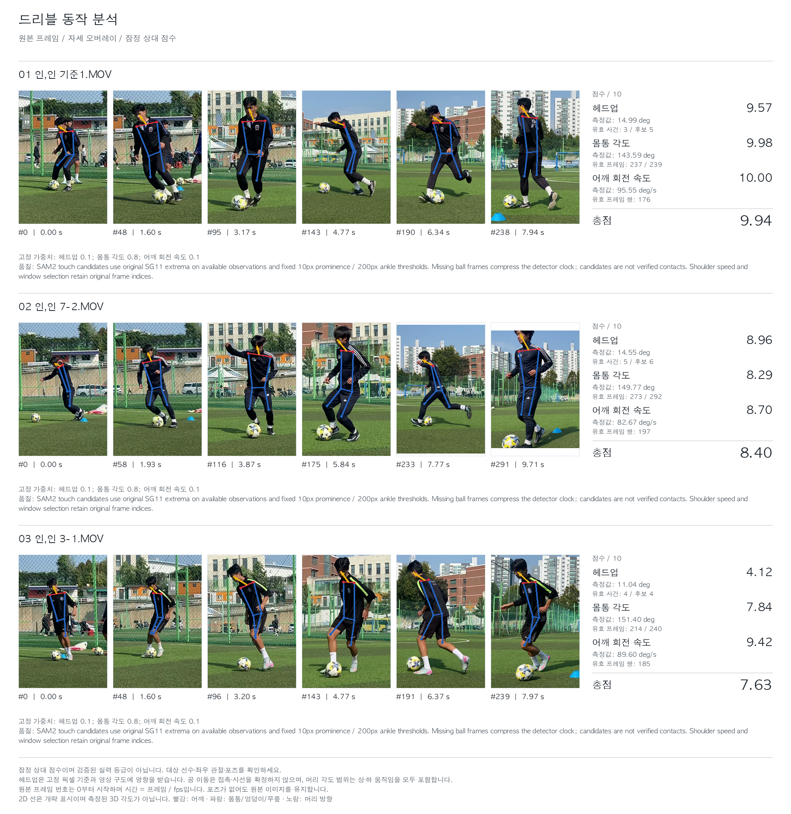

# Soccer Dribble Motion Analysis — YOLOv8 + SAM2



> 실제 원본 3편에서 추출한 YOLOv8+SAM2 자료로 어깨 ±16 설정을 다시 계산한 결과입니다. [상세 보고서](docs/example-report.html)와 [원시값 JSON](docs/example-report.json)을 함께 제공합니다. 점수는 잠정 비교값이며 전문가 등급 예측값이 아닙니다.

원본 드리블 영상에서 헤드업, 상체 각도, 어깨 속도를 측정하는 연구용 도구입니다.
한 영상의 실제 장면을 한 줄로 이어 붙여 점수와 함께 보여 줍니다.
여러 영상을 입력하면 같은 환산 기준으로 나란히 비교합니다.
기본 공 추적은 원래 논문의 공 추적 방식인 **YOLOv8n + SAM2.1 Hiera Small**입니다.
어깨 속도는 SAM2 터치 후보 중심 **±16 원본 프레임**에서 평균합니다.[^window]

## 설치

Python **3.11**을 사용합니다. 최초 패키지와 모델 설치에는 인터넷이 필요하며, 분석은 로컬에서 실행합니다.

```bash
git clone --depth 1 https://github.com/jiwoo1105/soccer_motion_analysis.git
cd soccer_motion_analysis
python3.11 -m venv .venv
source .venv/bin/activate
python -m pip install --upgrade pip
python -m pip install -r requirements.txt
python -m pip install -r requirements-sam2.txt
python scripts/setup_models.py
```

모델 준비 명령은 공식 MediaPipe Pose Heavy, YOLOv8n, SAM2 Small 가중치를 내려받고 SHA-256을 확인합니다. 분석 시 기본 경로는 `models/yolov8n.pt`와 `sam2_checkpoints/sam2.1_hiera_small.pt`입니다. 모델과 원본 영상은 Git에 포함하지 않습니다.

Windows, CPU/MPS 설치 옵션과 수동 모델 준비는 [상세 사용법](docs/usage.md)을 참고합니다.

## 영상 한 편

머리부터 발과 공까지 보이는 선수 한 명의 영상을 준비합니다.

```bash
mkdir -p input
# 분석할 영상을 input/my_dribble.mp4 로 복사
python analyze_video.py \
  --video "input/my_dribble.mp4" \
  --output "output/my_dribble" \
  --ball-backend yolov8_sam2 \
  --device cpu
```

완료 후 **`output/my_dribble/report.html`**을 브라우저로 엽니다. 공유할 때는 같은 폴더의 `panorama.png`도 함께 전달합니다. 출력 폴더는 덮어쓰지 않으므로 재실행 시 `output/my_dribble_v2`처럼 새 이름을 지정합니다.

## 여러 영상 비교

```bash
python analyze_video.py \
  --video "input/reference.mp4" "input/player_a.mp4" "input/player_b.mp4" \
  --output "output/comparison" \
  --device cpu
```

기본 backend는 `yolov8_sam2`입니다. 입력 순서대로 행을 만들며, 파일명이나 `reference`라는 이름은 점수에 영향을 주지 않습니다. SAM2 패키지나 체크포인트가 없으면 오류를 내며 다른 방식으로 자동 전환하지 않습니다.

## 결과 파일

| 파일 | 내용 |
|---|---|
| `panorama.png` | 실제 장면 6장과 관절 표시, 항목별 점수와 총점 |
| `report.html` | 이미지, 점수표, 계산 불가 이유와 품질 안내 |
| `report.json` | 원시값, 설정, 유효 구간과 진단 정보 |
| `clips/clip-*/pose.npz` | 원본 프레임 번호를 유지한 2D/3D 관절 좌표 |
| `clips/clip-*/tracks.json` | SAM2 공 추적 자료 |
| `clips/clip-*/metadata.json` | 공 처리 경로, FPS, 해상도, 모델과 파일 해시 |

## 점수 읽기

| 항목 | 측정값 | 기본 비중 |
|---|---|---:|
| 헤드업 | 터치 후보 앞뒤 16프레임의 머리 각도 범위 평균 | 10% |
| 상체 각도 | 좌우 무릎–엉덩이–어깨 각도의 영상 평균 | 80% |
| 어깨 속도 | 터치 후보 ±16프레임 안의 어깨 벡터 3D 방향 변화 속도 평균 | 10% |

총점은 세 항목 점수의 가중합입니다. 하나라도 계산할 수 없으면 해당 항목과 총점은 **`N/A`**입니다. 터치가 없거나 어깨의 유효 이웃 쌍이 없어도 어깨와 총점은 `N/A`이며, 결측을 0점으로 바꾸거나 비중을 재분배하지 않습니다.

각도 정의와 어깨 순간 속도 계산은 유지하고 어깨의 평균 구간을 바꿨습니다. 같은 터치 창 안의 원본 이웃 쌍만 사용하며 겹치는 쌍은 한 번만 셉니다. 자세한 환산과 품질 조건은 [계산 방법](docs/methods.md)에 있습니다.

## 해석할 때의 한계

- 단안 3D 추정이므로 가려짐, 좌우 혼동, 다른 사람 추적 오류를 원본에서 확인해야 합니다.
- 헤드업은 시선이 아닌 각도 변화 폭, 상체는 다리 자세도 반영하는 고관절 각도, 어깨는 XYZ 방향 변화입니다.
- 픽셀 임계값과 고정 프레임 창은 해상도와 FPS에 영향을 받습니다. 기존 설정은 약 30fps 자료를 바탕으로 합니다.
- 터치 검출은 관측된 공 좌표만 모아 평활화한 뒤 프레임 번호를 복원하므로 결측 구간의 시간이 압축됩니다. SAM2 후보도 실제 접촉 정답은 아닙니다.
- 소규모 탐색용 점수입니다. 헤드업 환산 경계는 과거 ROI 탐색값을 고정한 것으로, 새 SAM2 보정이나 독립적인 숙련도 예측 성능을 검증한 값이 아닙니다.

[^window]: 헤드업과 같은 터치 주변 구간을 평가하기 위해 어깨도 ±16으로 설정했습니다. 11편 탐색에서 ±30의 등급 순위상관이 더 높았지만, 항목별 정답이나 독립 검증을 통한 최적값은 아닙니다. 같은 시간 범위라도 항목별 유효 프레임과 유효 터치는 다를 수 있습니다.

## 더 보기

- [상세 사용법](docs/usage.md): 가중치, 선수 영역, 캐시, 글꼴, 오프라인 모델, YOLO11 ROI 대안
- [계산 방법](docs/methods.md), [이전 코드와의 차이](docs/migration.md)
- [공 추적 출처 감사](docs/touch-source-audit.md), [실행 검증 기록](docs/validation.md)
- [논문](docs/paper-touch-window.md), [기본 SAM2 구조도](docs/images/paper-touch-window-architecture.png), [과거 ±30 집계 예시](docs/images/touch-window-example.png)
