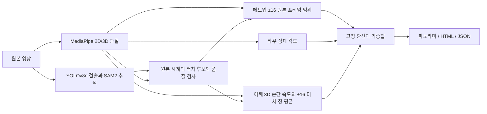

# 측정과 점수 환산

기본 공 처리 경로는 원 연구와 같은 **YOLOv8n+SAM2 (`sam2.1_hiera_small`)**입니다. YOLO11s 발목 ROI 검출은 선택 가능한 별도 대안이며, [논문](paper-touch-window.md)의 원래 공 추적 방식과 구분합니다. `2026-10-11-sam2-touch16` 프로필은 어깨 집계를 SAM2 터치 중심 ±16 원본 프레임으로 제한합니다. 헤드업과 동일한 시간 범위를 쓰는 설정이며, 등급과의 상관이 가장 높은 창이라는 의미는 아닙니다.

## 기본 처리 순서

위 흐름은 기본 `yolov8_sam2` 경로입니다. 논문과 [아키텍처](images/paper-touch-window-architecture.png)는 원 연구의 YOLOv8+SAM2 검출, 추적을 유지하고 어깨 집계와 터치→어깨 의존 관계를 반영합니다. 헤드업 각도 정의, ±16 범위, 상체 알고리즘과 어깨 순간 속도 계산은 유지합니다. SAM2에서 얻은 터치도 자동 검출 후보이며 모든 실제 접촉의 정답임을 보장하지 않습니다.

### 터치 후보와 경로별 출처

터치 중심 `T_k`는 선택한 공 처리 경로에서 얻은 **후보**의 원본 프레임 번호입니다. 기본 경로에서는 SAM2 궤적의 중심을 사용하고 원래 공, 헤드업 품질 규칙을 유지합니다. 어깨 후보 선정은 머리, 눈 품질과 분리하며, 이후 헤드업과 어깨가 각각 자신의 관절 품질과 집계 창을 적용합니다. 머리 결측 때문에 헤드업 창이 탈락해도 해당 터치를 어깨에서 함께 버리지 않습니다. 검출기나 추적기를 원래 방식으로 맞추는 것과 과거 표의 모든 값을 재현하는 것은 별도의 확인 사항입니다.

원래 검출기는 **관측된 공 좌표만 모은 열**에서 X좌표를 최대 SG11, 2차식으로 평활화하고 극값을 찾은 뒤 원본 프레임 번호로 돌려놓습니다. 극값의 prominence는 10px, 같은 극성의 간격은 관측열에서 8개이며 반대 극성 후보는 더 가까울 수 있습니다. 가까운 발목까지 200px 이내인지 검사합니다. 공 결측의 시간 간격이 압축된 채 평활화, 극값 탐지가 이뤄지는 알려진 한계가 있습니다. 아래 어깨 속도, 창 집계는 별도로 원본 이웃 관계를 보존하며 결측을 건너뛰지 않습니다.

기존 YOLO11 ROI 대안은 발목 주변 공 후보의 크기, 형태, 거리를 검사하고 3프레임 이하 결측과 40px/프레임 이하 이동에만 보간을 적용했습니다. SG11, 2차 평활화, 극값 간격 8프레임, prominence 10px, 실제 관측 중심, 발목 거리 200px 이하, visibility 0.5 이상, ±13 공 좌표 연속성, ±8 관측 비율 80% 이상, 80px 초과 점프 배제가 해당 경로의 조건입니다. 이 ROI 조건은 원래 논문의 공 추적 방식인 SAM2 경로의 설명이 아닙니다.

## 1. 헤드업

눈 두 점의 중점에서 어깨 두 점의 중점을 뺀 벡터를 `h(t)`로 둡니다. 이 벡터와 수직 방향 `(0, −1, 0)` 사이의 각도를 `φ(t)`로 계산합니다. 필요한 관절은 양쪽 눈 2, 5와 양쪽 어깨 11, 12입니다.

$$
\phi(t)=\arccos\frac{h(t)\cdot(0,-1,0)}{\|h(t)\|},\qquad
H=\frac{1}{K}\sum_{k=1}^{K}\left[\max_{t\in[T_k-16,T_k+16]}\phi(t)-\min_{t\in[T_k-16,T_k+16]}\phi(t)\right]
$$

각도는 도 단위이며, 여기서 `K`와 `T_k`는 헤드업 품질 검사까지 통과한 창의 수와 중심입니다. 헤드업 반폭은 기존 기호 `Δ=16`으로 유지합니다. ±16은 앞 16장, 현재 1장, 뒤 16장으로 총 33장입니다. 약 30fps에서 양 끝 사이 시간은 약 1.07초입니다.

각 중심의 기존 ±8 구간에는 SAM2 공 좌표가 연속으로 있어야 하고, 확장한 ±16 전체에는 유효한 머리 각도와 필요한 관절 visibility 0.5 이상이 필요합니다. 이 33프레임 창이 2개 이상이어야 `H`를 계산합니다. 각 창은 독립적인 영상 표본으로 취급하지 않으며 원본 터치 정답과 일치한다고 자동 확정하지 않습니다.

헤드업 환산식과 기존 운영 경계를 고정해 사용합니다.

$$
S_H=3+7\,\operatorname{clip}\left(\frac{H-10.225053625082124}{15.30499039887986-10.225053625082124},0,1\right)
$$

두 경계는 과거 ROI 기반 ±16 탐색의 운영값입니다. SAM2 터치 중심으로 원시값 `H`를 다시 계산하되 경계는 다시 맞추지 않았으며, 새 SAM2 자료에 대해 검증된 보정값도 아닙니다. `3`과 `10`은 표시 눈금이며 전문가 등급의 정답 경계가 아닙니다. 상한을 넘으면 10점으로 제한하고 원시값 `H`도 남깁니다. 이는 머리 움직임의 폭이므로 실제 시선이나 고개를 든 방향 자체를 판별하지 않습니다.

## 2. 상체 각도

왼쪽은 무릎25–엉덩이23–어깨11, 오른쪽은 무릎26–엉덩이24–어깨12의 각도를 엉덩이를 꼭지점으로 구합니다. 필요한 여섯 관절의 좌표와 visibility가 유효하고 두 변의 길이가 0보다 큰 프레임만 사용합니다.

$$
\theta=\operatorname{mean}_{t\in\mathcal V}\left[\frac{\alpha_L(t)+\alpha_R(t)}{2}\right],\qquad
S_T=10\,\operatorname{clip}\left(\frac{180-\theta}{36.4628217436476},0,1\right)
$$

`α_L`, `α_R`은 각 측면의 3D 각도이고 `𝒱`는 양쪽 모두 유효한 프레임 집합입니다. 기준 보각 36.4628217436476°는 기존 기준 영상 두 편의 평균에서 고정했습니다. 각도 자체 `θ`와 환산값을 구분해 저장합니다. 한쪽만 남은 프레임으로 임의 대체하지 않습니다.

이 값은 고관절 굽힘을 포함한 관절 각도입니다. 몸통의 지면 기준 기울기와 동일하지 않으며, 무릎이나 다리의 위치 변화가 영향을 줍니다.

## 3. 어깨 방향 변화 속도

어깨 벡터 방향이 연속 프레임 사이에서 얼마나 빨리 달라지는지 계산합니다. 순간 속도의 정의와 품질 마스크는 유지하고, 평균할 프레임 쌍을 터치 창 안으로 제한합니다.

1. 3D world 좌표의 오른쪽 어깨12에서 왼쪽 어깨11을 빼고 길이를 1로 맞춰 단위 방향 `u(t)`를 만듭니다.
2. 연속 유효 구간 안에서 X, Y, Z 각각에 SG13, 2차식 필터를 적용합니다. 필터 결과를 다시 길이 1로 맞춘 방향을 `û(t)`로 둡니다. 필터 길이 `W_s=13`, 차수 `p_s=2`는 유지합니다.
3. 원본에서 바로 이웃한 두 유효 프레임의 방향각 차이 `δ(t)`를 계산하고 FPS `f`를 곱합니다.
4. 품질 조건을 통과한 원본 이웃 쌍 중 두 끝점이 **동일한** 터치 중심 ±B_sh 프레임 안에 있는 쌍만 합집합으로 모아 평균합니다. 겹친 창에서 같은 쌍을 중복 집계하지 않습니다.

어깨 창 반폭은 헤드업의 `Δ`와 구별해 `B_sh=16`으로 표기합니다. 헤드업과 같은 터치 주변 시간 범위를 사용하기 위한 값입니다. 원본 프레임 인덱스를 유지하며 다음과 같이 정의합니다. `𝒫₀`는 어깨 품질, 평활화 조건을 통과한 원본 이웃 쌍의 집합이고, `T_k`는 머리, 눈 품질과 독립적인 SAM2 터치 후보 전체입니다.

$$
I_k=\{t:0\le t<n,\;T_k-B_{\mathrm{sh}}\le t\le T_k+B_{\mathrm{sh}}\},\qquad
\mathcal P=\bigcup_k\{(t-1,t)\in\mathcal P_0:t-1\in I_k,\;t\in I_k\}
$$

양 끝점이 서로 다른 창에만 속하는 쌍은 포함하지 않습니다. 유효 프레임만 추려 재번호를 매기거나 결측, 제외 프레임을 건너뛴 쌍을 만들지 않습니다. 각 창의 평균을 다시 평균하는 대신, 중복 제거한 쌍마다 한 번씩 같은 비중을 줍니다. 영상 경계의 부분 창에서도 지원되는 원본 이웃 쌍은 사용할 수 있습니다. `B_sh=16`에서는 창이 최대 33프레임이며 30fps에서 양 끝 사이 약1.07초입니다. 이 반폭은 아래 품질 조건의 최소 연속 길이 24프레임과 별개입니다.

$$
\delta(t)=\frac{180}{\pi}\operatorname{atan2}\left(\|\hat u(t-1)\times\hat u(t)\|,\hat u(t-1)\cdot\hat u(t)\right)
$$

$$
V=\frac{1}{|\mathcal P|}\sum_{(t-1,t)\in\mathcal P}\delta(t)f,\qquad
S_S=10\,\operatorname{clip}\left(\frac{V}{V_{\mathrm{ref}}},0,1\right)
$$

`δ`는 도, `V`는 도/초입니다. 예를 들어 30fps에서 두 이웃 방향이 3° 차이 나면 그 쌍의 속도는 90°/초입니다. 이를 선택한 쌍에서 평균하므로, 한 번 크게 돈 각도나 왕복 한 주기의 폭을 뜻하지 않습니다. `V_ref`는 원래 SAM2 자료의 10점 기준 영상 두 편에 같은 ±16 창을 적용한 평균 **96.65652026544726°/s**입니다. 과거 ROI 후보 연구의 ±24 기준 98.88202612670571°/s 및 새 CLI 재추론값과 구분합니다. 실행 때마다 입력 영상으로 기준을 다시 맞추지는 않습니다.

[과거 ±30 터치 창과 어깨 집계 예시](images/touch-window-example.png). 현재 ±16 결과와 구분합니다. 그림의 입력 경로와 창 크기는 함께 제공되는 출처 기록으로 구분하며, 기존 ROI 그림을 SAM2 재계산 증거로 사용하지 않습니다.

### 어깨 품질 조건

- 좌표가 유한하고 양쪽 visibility ≥ 0.5이며 이미지 관절이 화면 안에 있어야 합니다.
- 어깨 벡터 길이가 1e−5보다 크고 XZ 투영 길이가 전체 길이의 0.05배보다 커야 합니다.
- 바로 이웃한 원시 방향의 차이가 45°를 넘거나 두 어깨 길이 중 큰 값/작은 값의 비율이 1.5를 넘으면 두 끝 프레임을 제외합니다.
- SG9, SG13, SG21에서 평활화 벡터 길이가 모두 0.2를 넘는 공통 구간을 집계합니다. SG13을 실제 속도 계산에 사용합니다.
- 연속 구간은 최소 24프레임이어야 하며 양 끝 11프레임은 집계하지 않습니다. 결측 앞뒤를 이어서 각속도를 계산하지 않습니다.

갑작스러운 관절 튐 일부를 걸러내는 수치 조건입니다. 서서히 잘못 따라가는 추적, 다른 사람의 관절, 실제 빠른 동작과 추정 오류를 완전히 구분하는 판별기는 아닙니다. 그림의 여섯 장만으로 영상 전체 추적이 검증되는 것도 아닙니다.

## 4. 총점과 결측

$$
S=0.10S_H+0.80S_T+0.10S_S
$$

합산에는 반올림 전 값을 사용합니다. 입력으로 지정한 가중치를 기록하며 합이 1이 아니면 오류를 냅니다. 하나라도 계산 불가이면 총점은 N/A입니다. 계산 가능한 최소 표본 수는 헤드업 이벤트 2개, 상체 양쪽 유효 프레임 1개, 어깨 유효 이웃 쌍 1개입니다. 이 최소값은 계산 가능 조건이며 촬영 품질의 충분조건으로 검증한 기준은 아닙니다. 현재 가중치는 운영 비교안이며 새 영상의 등급을 잘 예측한다고 확정한 값은 아닙니다.

유효 터치 후보가 없거나 그 창 안에 어깨 유효 이웃 쌍이 없으면 어깨와 총점은 N/A입니다. 영상 전체 평균으로 대신하지 않습니다. 반대로 터치는 유효하지만 머리, 눈 품질이 부족한 경우 어깨 값은 남을 수 있어도 헤드업과 총점은 N/A입니다.

라이브러리의 `measure_video(..., excluded_frames=...)`에는 원본에서 직접 확인한 실패 프레임을 전달할 수 있습니다. 해당 마스크는 세 항목에 모두 적용됩니다. CLI는 과거 영상의 이름별 검수 마스크를 자동 적용하지 않습니다. 따라서 새로 추론한 결과는 수동 검수가 포함된 과거 표와 다를 수 있습니다.

## 5. 원본 시계와 재현 범위

관절이 없는 프레임도 배열에 남기고 NaN으로 표시합니다. 원본 프레임 번호는 0부터 시작하며 표시 시간은 프레임 번호/영상 평균 FPS입니다. VFR 영상의 개별 디코더 PTS를 사용한 속도 계산은 구현하지 않았습니다. 정밀 비교에는 같은 고정 FPS 촬영 조건을 사용해야 합니다.

MediaPipe 자체의 `smooth_landmarks=True`를 사용하고, 어깨 단위 방향에는 추가 SG 평활화를 적용합니다. 실행 환경과 모델 파일 해시를 저장하지만 GPU, 디코더, 운영체제가 바뀐 경우 비트 단위 일치까지 보장하지 않습니다. 이미지의 고관절 선과 머리 화살표는 화면상의 안내 표시이며, 계산된 3D 각도를 2D 사진 각도로 대체하지 않습니다.

## 6. 창 선택과 자료 출처

어깨 창 반폭 `N∈{6, 10, 16, 20, 24, 30}` 여섯 가지를 비교한 뒤, 헤드업과 같은 시간 범위를 사용하도록 `B_sh=16`으로 설정했습니다. 이전 탐색에서 전체 등급과의 상관이 가장 높았던 ±30과 구분합니다. 아래는 **어깨 원시 평균속도와 전체 드리블 등급의 Spearman 상관**으로, 총점 상관이 아닙니다. [SAM2 여섯 창 통계](data/touch-window-sam2-statistics.csv)와 [후보별 원시값](data/touch-window-sam2-candidates.csv)을 제공합니다. 기존 ROI 탐색 결과와 출처를 분리합니다.

| 자료, 집계 방식 | 11편의 Spearman ρ | 10점 기준 두 편을 제외한 9편의 ρ |
|---|---:|---:|
| 원래 SAM2 자료, 현재 ±16 창 | 0.551761 | 0.177992 |
| 원래 SAM2 자료, 이전 ±30 창 | 0.602339 | 0.271225 |
| 과거 ROI 자료, ±24 창 | 0.56555 | 0.20342 |
| 과거 ROI 자료, 영상 전체 | 0.56555 | 0.271 |

서로 다른 터치 출처의 상관을 직접 비교해 개선으로 해석하지 않습니다. 같은 소규모 자료의 반복 탐색이며 독립 검증도 아닙니다. 현재 ±16은 두 항목의 시간 범위를 맞추기 위한 선택입니다. **선택에 사용한 자동 후보에는 의심 이벤트가 포함됩니다.** 전체 드리블 등급과의 상관은 항목별 정답 검증이나 모든 SAM2 터치의 정확성을 뜻하지 않습니다. 겹치는 창이나 프레임 쌍을 독립적인 영상 표본으로 세지 않습니다.

이전 ±16 헤드업 표는 `calculate.py`의 ROI 이벤트를 사용했고, 이전 어깨 탐색은 검수된 과거 캐시와 `roi_head_results.json`을 재사용했습니다. 해당 배치 메타데이터의 모델은 `yolo11s.pt`였습니다. 따라서 이 표들을 원래 논문의 공 추적 방식으로 얻은 결과로 표시하지 않습니다. 새 기본 경로는 SAM2 터치 중심에 동일한 ±16 각도 범위를 적용하되 과거 ROI 운영 경계를 고정해 사용합니다. 좌우 상체 평균, 기준 보각 36.4628217436476°와 10/80/10 비중도 유지합니다. [기존 실행 검증 기록](validation.md)의 횟수, 점수와 예시 보고서는 당시 버전의 기록이며 새 기본 경로의 실행 검증을 대신하지 않습니다.
