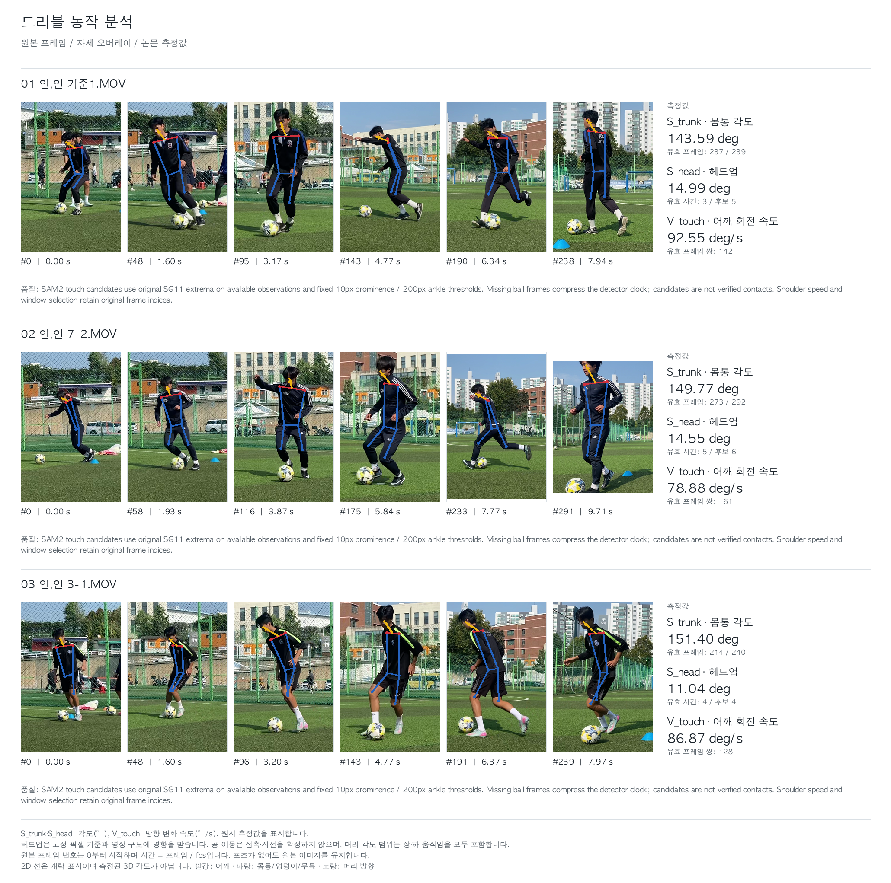

# 논문 그림의 세 샘플

2026-10-16에 현재 코드로 다시 계산한 원시 측정값입니다. 영상과 저장된 관절·공 추적 파일의 SHA-256을 확인한 뒤, 기존 YOLOv8+SAM2 추출 결과를 재생하여 계산했습니다. 모델 추론을 새로 실행한 결과는 아닙니다.

| 영상 | S_trunk (°) | S_head (°) | V_touch (°/s) |
|---|---:|---:|---:|
| 기준1 | 143.59 | 14.99 | 92.55 |
| 7-2 | 149.77 | 14.55 | 78.88 |
| 3-1 | 151.40 | 11.04 | 86.87 |

- **S_trunk**: 전체 유효 프레임의 좌우 무릎–엉덩이–어깨 각도 평균. 180°에서 뺀 보각이나 환산 점수가 아닙니다.
- **S_head**: 유효 터치 후보 앞뒤 각각 16프레임의 머리 각도 범위를 구한 뒤 터치별로 평균한 값입니다.
- **V_touch**: 같은 터치 후보 ±16프레임 안의 원본 인접 프레임 쌍에서 어깨 방향 변화 속도를 평균한 값입니다. 방향 성분은 SG13, 2차식으로 평활화합니다. 겹치는 쌍은 한 번만 집계합니다.

| 영상 | 상체 유효 프레임 | 헤드업 유효 터치 / 후보 | 어깨 유효 쌍 |
|---|---:|---:|---:|
| 기준1 | 237 / 239 | 3 / 5 | 142 |
| 7-2 | 273 / 292 | 5 / 6 | 161 |
| 3-1 | 214 / 240 | 4 / 4 | 128 |

세 값은 단위와 의미가 달라 그대로 더하지 않습니다. 각도나 속도 자체를 전문가의 전체 등급으로 해석하지 않습니다.

## 이전 노션 연구 표와의 차이

이 파일은 현재 공개 실행 코드의 **자동 유효성 조건**을 사용하며 영상별 수동 제외 마스크를 적용하지 않습니다. 이전 연구 표에는 과거 SAM2 저장 궤적과 어깨 전용 수동 제외 조건이 사용되었습니다. 따라서 7-2의 헤드업·어깨 및 3-1의 어깨 값이 다릅니다. 윈도우가 달라진 결과가 아니며, 두 표의 값을 섞어서 사용하지 않습니다. 이전 연구 표는 그대로 보존했습니다.

[CSV](paper-samples.csv)에는 반올림 전 원시값과 유효 표본 수를, [JSON](paper-samples.json)에는 입력 해시·계산 설정·독립적인 프레임 쌍 집계 확인 결과를 기록했습니다. [HTML](paper-samples.html)에서는 원시값과 기존 환산 점수를 함께 볼 수 있습니다.

