# 터치 구간 어깨 평균속도 논문 수정안

원문에서 어깨 절, 개요/관절표의 어깨 명칭, 구조도 연결만 변경했습니다. 다른 절의 문장과 참고문헌은 보존했습니다. 측정값 정의와 잠정 점수 환산은 구분합니다.

### 3.1 시스템 개요
본 연구에서는 단안 카메라로 후방 촬영된 축구 드리블 영상에서 선수의 상체 움직임을 정량적으로 평가하는 시스템을 제안한다. 제안 시스템은 Fig. 1과 같이 (1) 관절 좌표 추출, (2) 공 추적  (3) 터치 시점 감지, (4) 평가지표 산출의 세 단계로 구성된다.

Fig. 1  아키텍쳐 구조
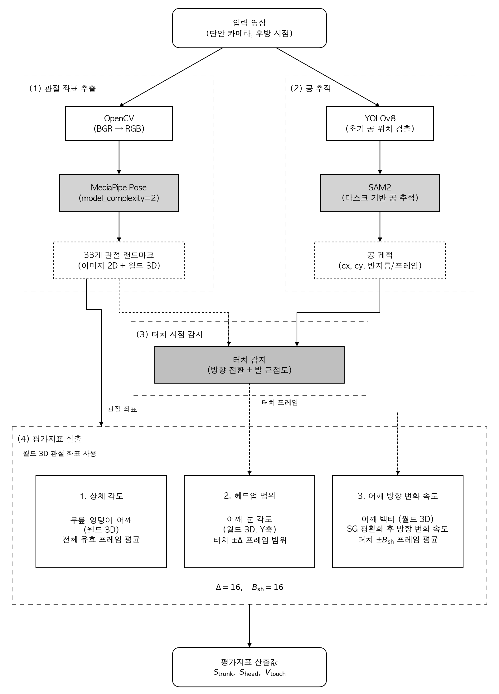
관절 좌표 추출에는 MediaPipe Pose\[1\]를, 공 추적에는 YOLOv8\[2\]과 SAM2\[3\]를 사용하였다. 추출된 관절 좌표와 공 터치 시점 정보를 바탕으로 상체 각도, 헤드업 범위, 터치 구간의 어깨 벡터 평균 방향 변화 속도의 세 가지 평가지표를 산출한다.
### 3.2 관절 좌표 추출
MediaPipe Pose\[1\]의  영상의 각 프레임 t에서 33개 관절의 좌표를 추출하였다. MediaPipe는 두 종류의 좌표계를 제공한다. 첫째, 화면을 기준으로 정규화된 2D 좌표인 image landmarks이다. t번째 프레임에서 i번째 관절의 image landmark인 I_i\^(t)는 다음과 같이 나타낼 수 있다.
$$
\mathbf{l}_i^{(t)} = (u_i^{(t)}, v_i^{(t)})
$$
여기서 t는 프레임 인덱스, i는 관절 인덱스(i = 0, 1, …, 32)이다. u_i\^(t)와 v_i\^(t)는 각각 영상의 너비와 높이로 정규화된 수평·수직 이미지 좌표로, \[0, 1\] 범위의 값을 가지며 영상의 좌측 상단을 원점으로 하여 u는 오른쪽으로, v는 아래쪽으로 증가한다.
둘째, 골반 중심을 원점으로 하는 미터 단위 3D 좌표인 world landmarks이다. t번째 프레임에서 i번째관절의 world landmark인 w_i\^(t)는 다음과 같이 나타낼 수 있다.
$$
\mathbf{w}_i^{(t)} = (x_i^{(t)}, y_i^{(t)}, z_i^{(t)})
$$
여기서 x_i\^(t), y_i\^(t), z_i\^(t)는 양쪽 엉덩이 관절의 중점(골반 중심)을 원점으로 하는 3차원 공간에서 i번째 관절의 좌표이며, 단위는 미터(m)이다. x축은 신체의 좌우 방향, y축은 수직 방향, z축은 카메라 광축에 평행한 전후 방향에 대응한다.
본 연구에서 사용한 관절 인덱스는 Table 1에 정리하였다. MediaPipe는 각 관절 랜드마크에 대해 해당 관절이 영상 내에서 가려지지 않고 관측될 가능성을 나타내는 visibility 값을 \[0, 1\] 범위로 제공한다. 본 연구에서는 이를 관절 좌표의 신뢰도 지표로 활용하여, 상체 각도와 헤드업 범위의 산출 시 각 지표의 계산에 필요한 관절 중 하나라도 visibility가 0.5 미만인 프레임은 해당 지표의 계산에서 제외하였다.

**Table 1. 본 연구에서 사용하는 Mediapipe 관절 인덱스 및 용도 스켈레톤 관절에 인덱스 표시한 그림 넣기**

<table header-row="true">
<tr>
<td>관절명</td>
<td>인덱스</td>
<td>사용 지표</td>
</tr>
<tr>
<td>LEFT/RIGHT_EYE</td>
<td>2, 5</td>
<td>헤드업</td>
</tr>
<tr>
<td>LEFT/RIGHT_SHOULDER</td>
<td>11, 12</td>
<td>상체각도, 헤드업, 터치 구간의 어깨 벡터 평균 방향 변화 속도</td>
</tr>
<tr>
<td>LEFT/RIGHT_HIP</td>
<td>23, 24</td>
<td>상체각도</td>
</tr>
<tr>
<td>LEFT/RIGHT_KNEE</td>
<td>25, 26</td>
<td>상체각도</td>
</tr>
<tr>
<td>LEFT/RIGHT_ANKLE</td>
<td>27, 28</td>
<td>터치 감지</td>
</tr>
</table>

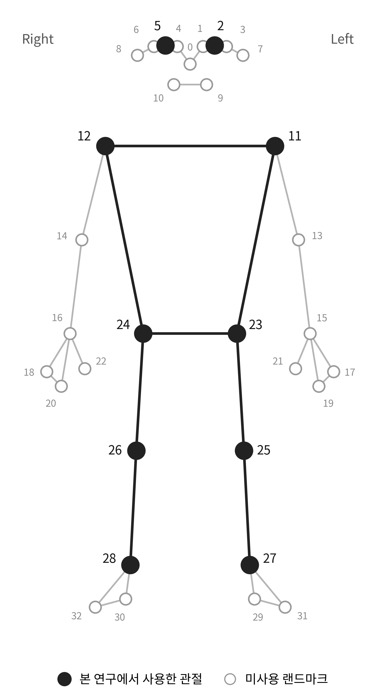

### 3.3 공 추적
공 추적은 초기 감지와 전체 프레임 추적의 두 단계로 수행하였다. 초기 감지 단계에서는 YOLOv8\[2\]을 이용하여 영상의 첫 20프레임에서 공 객체를 탐지하였다. 화면 내 공이 여러 개 검출될 경우 화면 하단 50% 영역 내의 후보 중 식 (1)로 정의된 점수가 최대인 객체를 추적 대상 공으로 선정하였다.
식(1)
$$
\mathrm{score}(b) = \frac{1}{d(\mathbf{c}_b, \mathbf{a}_b) + 1}
$$
여기서 b는 YOLOv8이 검출한 개별 후보 객체, c_b는 후보 객체 b의 경계 상자 중심의 이미지 좌표(픽셀), a_b는 c_b로부터 가장 가까운 발목 관절(인덱스 27, 28)의 이미지 좌표, d()는 유클리드 거리이다. 분모의 상수 1은 d = 0일 때 발산을 방지하기 위한 것이다. 식 (1)은 발목에 근접한 후보일수록 높은 점수를 부여하여, 드리블 중인 공이 선수의 발 부근에 위치한다는 사전 지식을 반영한다.
전체 프레임 추적 단계에서는 초기 감지 좌표를 SAM2\[3\] video predictor에 point prompt로 입력하여 전체 프레임에 대해 공의 분할 마스크를 전파하였다. 이후 각 프레임 t의 마스크로부터 공의 중심 좌표 b\^(t)와 등가 반지름 r\^(t)를 산출하였다.

$$
b^{(t)}=(c_x^{(t)}, c_y^{(t)})
$$

$$
r^{(t)} = \sqrt{\frac{A^{(t)}}{\pi}}
$$

여기서 A\^(t)는 프레임 t에서 마스크의 픽셀 면적이다. 이후 공의 중심 좌표를 b(t)로 표기한다.

#### **3.4 터치 시점 감지**
본 연구의 실험 과제인 드리블은 공을 양발 안쪽으로 번갈아 밀어 좌우로 왕복시키는 동작으로, 각 터치는 공의 수평 진행 방향을 반전시킨다. 이에 본 연구에서는 터치가 공의 수평 방향 전환을 동반한다고 가정하고, 공의 수평 좌표 시계열에서 방향 전환 시점을 탐색한 뒤 발 근접 조건을 결합하여 터치를 감지하였다. 이 가정 하에서 터치는 방향 전환 시점에서만 발생하므로, 한 방향 이동 구간 내에 터치는 최대 1회만 존재한다.
방향 전환 시점의 탐색을 위해, 먼저 공의 X좌표 시계열에 Savitzky-Golay 필터\[4\]를 적용하여 노이즈를 제거하였다. 필터의 윈도우 크기는 11, 다항식 차수는 2로 설정하였다. 이후 평활화된 시계열에서 극대점과 극소점을 탐색하여 방향 전환 후보 집합을 구성하였다. 극값 탐색에는 SciPy\[5\]의 find_peaks 함수를 사용하였으며, 극소점은 신호를 반전시킨 값에 동일 함수를 적용하여 탐색하였다.
$$
\mathcal{T}_{peak} = \mathrm{find\_peaks}(\tilde{c}_x, d_{min}=8, p_{min}=10)
$$
$$
\mathcal{T}_{valley} = \mathrm{find\_peaks}(-\tilde{c}_x, d_{min}=8, p_{min}=10)
$$
$$
\mathcal{T}_{turn} = \mathcal{T}_{peak} \cup \mathcal{T}_{valley}
$$
여기서 d_min은 극값 간 최소 프레임 간격으로, 짧은 시간 내 중복 검출을 방지한다(8프레임, 30fps 기준 약 0.27초). p_min은 극값의 최소 prominence로, 극값이 주변 신호 대비 돌출된 높이를 픽셀 단위로 나타낸다. 즉 10px 미만의 미세한 좌표 요동은 방향 전환으로 간주하지 않는다.
각 방향 전환 후보 시점에서 공과 양 발목 간 2D 거리의 최솟값을 산출하고 d_foot가 200px 미만인 시점만 터치로 확정하였다. 터치 시점 T_k는 아래 수식으로 표현된다.
$$
\mathcal{T}_{\mathrm{k}}
=
\left\{
t \in \mathcal{T}_{turn}
\;\middle|\;
d_{foot}^{(t)} < 200~\mathrm{px}
\right\}, \\d_{foot}^{(t)}=\min\left(\left\| \mathbf{b}^{(t)} - \mathbf{a}_{L}^{(t)} \right\|_2,\left\| \mathbf{b}^{(t)} - \mathbf{a}_{R}^{(t)} \right\|_2\right)
$$
(최대 1회만 존재하게 하기 위해 조치한 것 이 있나? 아니면 터치가 검출되면 무조건 방향이 바뀐다고 가정한 것인가? 가정은 방향 전환 설명하는 섹션 앞부분에서 같이 얘기해주는 것이 좋을 것 같음.)

## 3.5 평가지표
### 3.5.1 상체 각도
상체 각도는 드리블 시 선수의 상체 기울기를 정량화하기 위한 지표이다. 무릎, 엉덩이, 어깨가 이루는 각도를 엉덩이를 꼭지점으로 하여 산출하였다.
세 점 p_1, p_2, p_3이 이루는 각도를 다음과 같이 정의한다. 이때 p_2는 꼭지점이다.
$$
\angle(\mathbf{p}_1, \mathbf{p}_2, \mathbf{p}_3)=\arccos\left(\frac{(\mathbf{p}_1 - \mathbf{p}_2) \cdot (\mathbf{p}_3 - \mathbf{p}_2)}{\left\| \mathbf{p}_1 - \mathbf{p}_2 \right\|_2\left\| \mathbf{p}_3 - \mathbf{p}_2 \right\|_2}\right)
$$
좌측 및 우측 상체 각도는 world landmarks를 이용하여 다음과 같이 산출한다. 좌측 상체 각도 θ_L\^(t)는 왼쪽 무릎(인덱스 25), 왼쪽 엉덩이(인덱스 23), 왼쪽 어깨(인덱스 11)가 이루는 각도로, 왼쪽 엉덩이를 꼭지점으로 한다. 우측 상체 각도 θ_R\^(t)는 오른쪽 무릎(인덱스 26), 오른쪽 엉덩이(인덱스 24), 오른쪽 어깨(인덱스 12)에 대해 동일하게 정의한다.

$$
\alpha_L^{(t)}=\angle\left(\mathbf{w}_{25}^{(t)},\mathbf{w}_{23}^{(t)},\mathbf{w}_{11}^{(t)}\right)
$$

$$
\alpha_R^{(t)}=\angle\left(\mathbf{w}_{26}^{(t)},\mathbf{w}_{24}^{(t)},\mathbf{w}_{12}^{(t)}\right)
$$

전체 프레임 평균으로 상체 각도 점수를 산출한다.
$$
S_{trunk}=\frac{1}{T}\sum_{t=1}^{T}\frac{\alpha_L^{(t)} + \alpha_R^{(t)}}{2}
$$
S_trunk가 낮을수록 상체를 숙인 자세를 나타내며, 이는 드리블 시 공과의 거리 유지 및 중심 이동에 유리한 것으로 알려져 있다 .

- 196 프레임
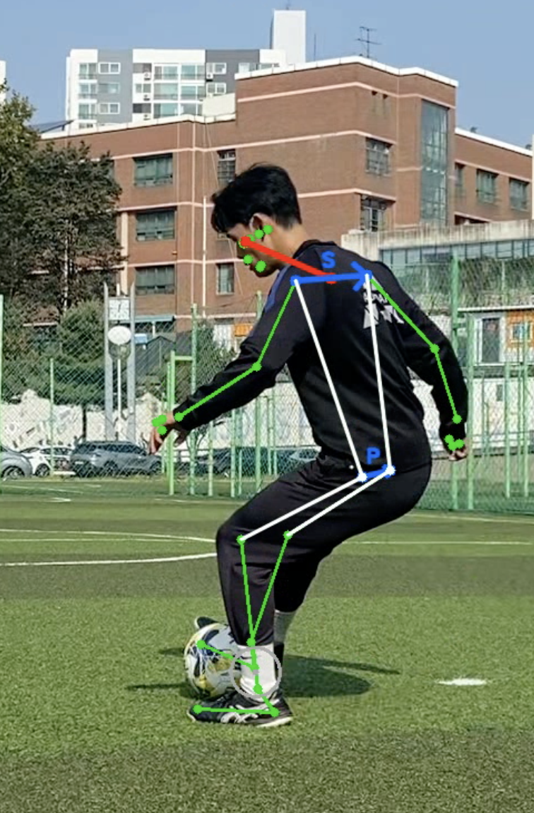

- 178 프레임
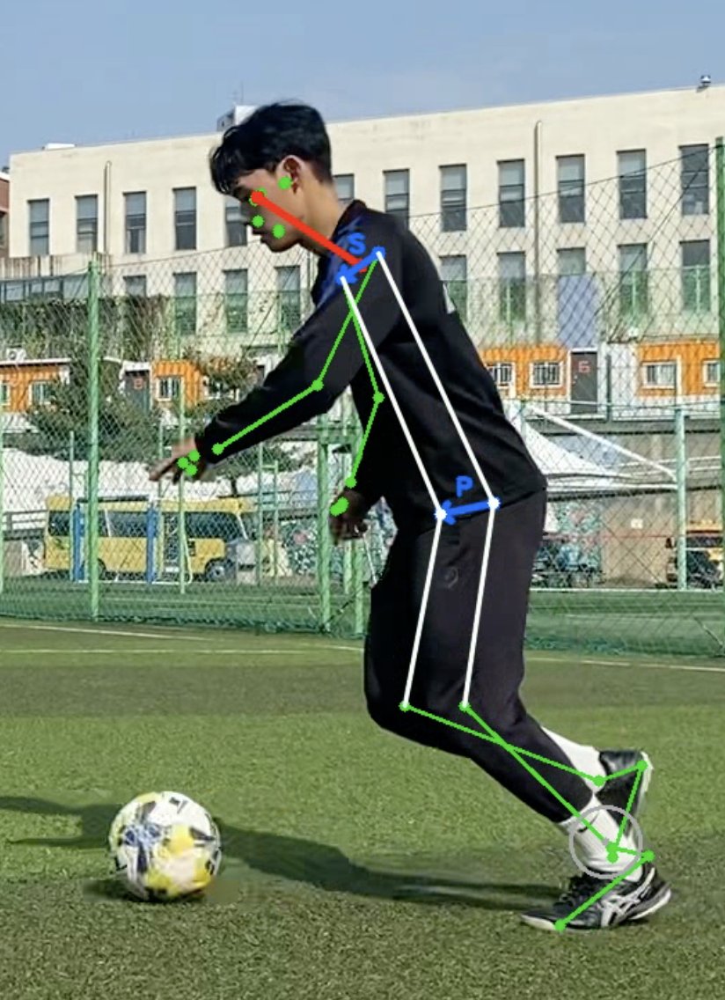

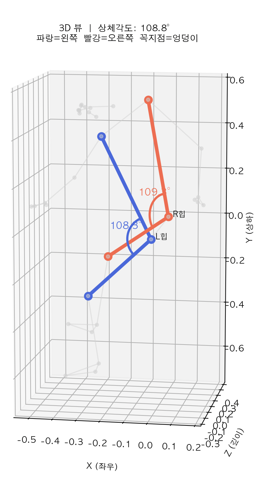

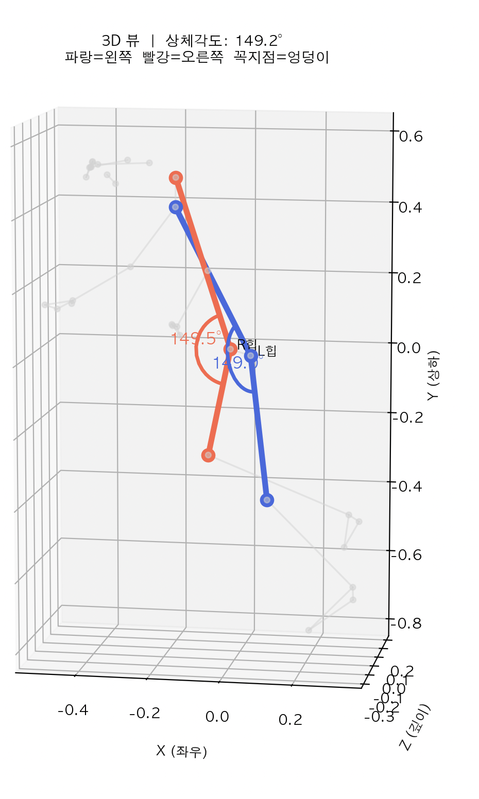

### 3.5.2 헤드업 범위
헤드업 범위는 터치 전후 선수의 시선 이동 정도를 나타내는 지표로, 주변 시야 확보 능력을 반영한다 **(이것도 레퍼런스)**. t번째 프레임에서의 어깨 중앙점 m_sh\^(t)과 눈 중앙점 m_eye\^(t)을 다음과 같이 정의한다.

$$
\mathbf{m}_{sh}^{(t)}=\frac{\mathbf{w}_{11}^{(t)} + \mathbf{w}_{12}^{(t)}}{2}
$$

$$
\mathbf{m}_{eye}^{(t)}=\frac{\mathbf{w}_{2}^{(t)} + \mathbf{w}_{5}^{(t)}}{2}
$$

t번째 프레임에서의 어깨 중앙점과 눈 중앙점을 잇는 머리 방향 벡터 h_(t)를 다음과 같이 정의한다.
$$
\mathbf{h}^{(t)}=\mathbf{m}_{eye}^{(t)} - \mathbf{m}_{sh}^{(t)}.
$$
머리 방향 벡터를 이용해 수직축에 대한 머리 각도를 다음과 같이 산출한다.
$$
\phi^{(t)}=\arccos\left(\frac{\mathbf{h}^{(t)} \cdot \mathbf{y}}{\left\| \mathbf{h}^{(t)} \right\|_2\left\| \mathbf{y} \right\|_2}\right),
$$
$$
\mathbf{y} = (0, -1, 0).
$$

- 101 프레임
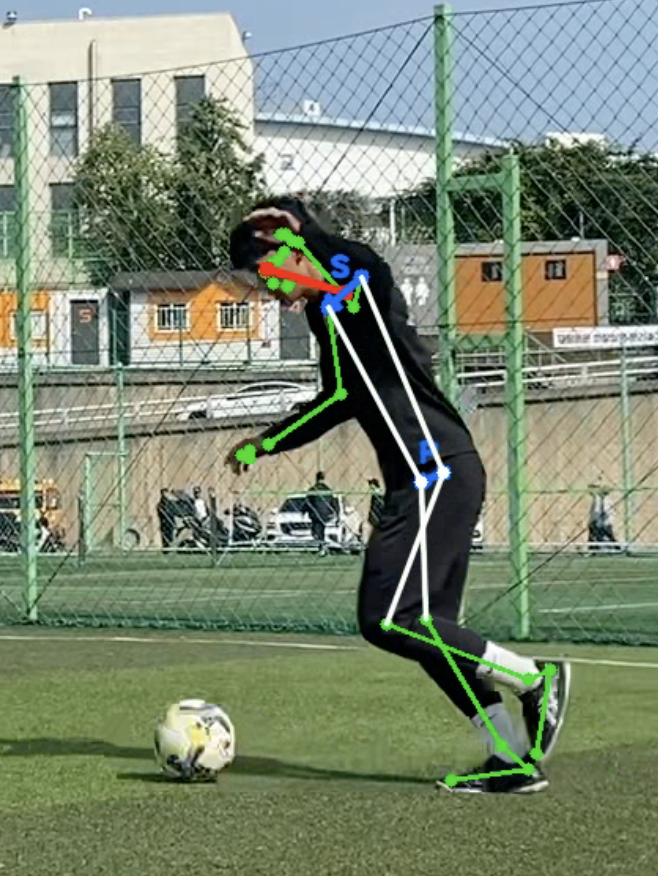

- 133 프레임
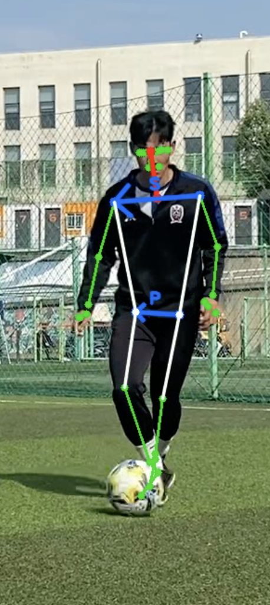

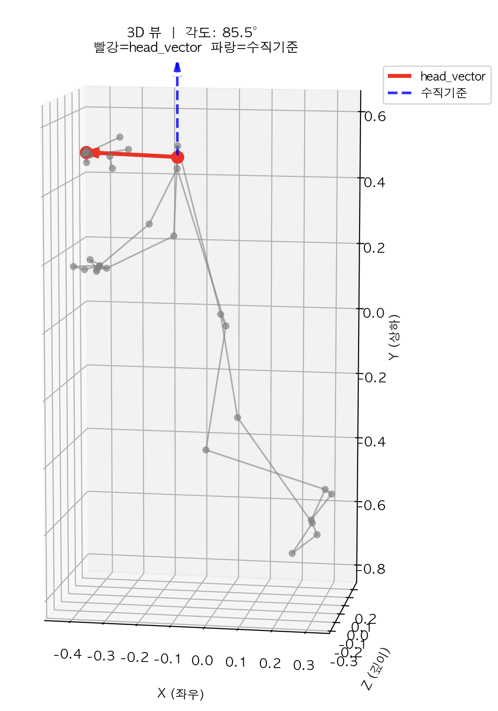

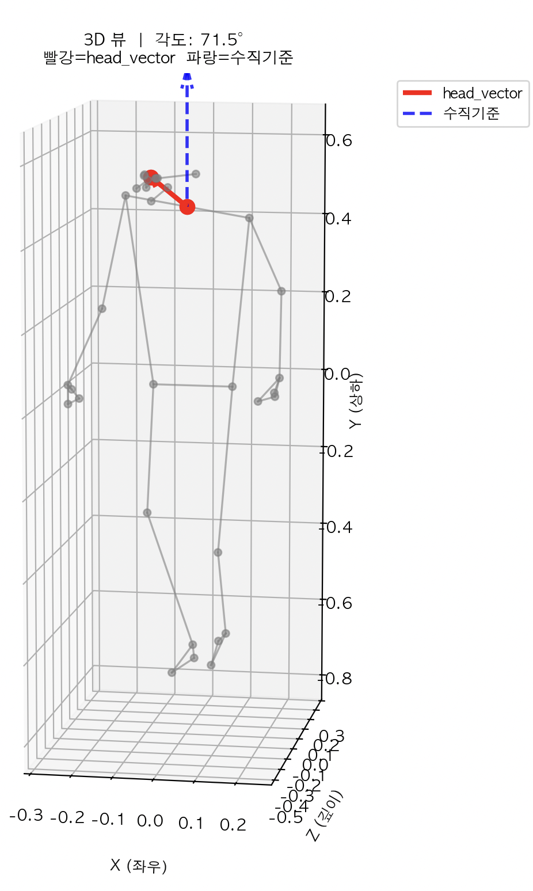

이후, 각 터치 시점  T_k를 중심으로 전후 Δ프레임 윈도우 내의 머리 각도 범위를 산출한다(Δ=16). (수식에는 전후로 나눠  Δ/2로 표기돼야 맞는지 확인) 전체 K회 터치에 대한 평균 머리 각도 범위를 헤드업 점수 S_head로 정의한다. S_head가 클수록 터치 전후에 머리를 많이 움직여 주변 상황을 인지하는 것을 의미한다.
$$
R_k=\max_{t \in [t_k - \Delta, t_k + \Delta]} \phi^{(t)}-\min_{t \in [t_k - \Delta, t_k + \Delta]} \phi^{(t)},
$$
$$
S_{head}=\frac{1}{K}\sum_{k=1}^{K}R_k.
$$

---
### 3.5.3 터치 구간의 어깨 벡터 평균 방향 변화 속도
어깨 움직임은 왼쪽 어깨에서 오른쪽 어깨로 향하는 벡터의 3차원 방향 변화 속도로 정량화한다. t번째 프레임의 어깨 벡터 s⁽ᵗ⁾와 단위 방향 벡터 n⁽ᵗ⁾를 다음과 같이 정의한다.
$$
\color{#387dc9}{\mathbf{s}^{(t)}=\mathbf{w}_{12}^{(t)}-\mathbf{w}_{11}^{(t)},\qquad \mathbf{n}^{(t)}=\frac{\mathbf{s}^{(t)}}{\|\mathbf{s}^{(t)}\|_2}}
$$
여기서 w₁₁⁽ᵗ⁾와 w₁₂⁽ᵗ⁾는 선수의 왼쪽과 오른쪽 어깨의 world landmark이며, ∥ ∥₂는 벡터의 길이이다. n⁽ᵗ⁾는 어깨 폭의 영향을 제외하고 방향만 비교하기 위해 길이를 1로 정규화한 벡터이다.
추적 오류와 낮은 가시성의 프레임을 제외한 뒤, 연속된 유효 구간에서 n⁽ᵗ⁾의 각 XYZ 성분에 Savitzky–Golay 필터\[4\]를 적용한다. 윈도우 크기를 $\color{#387dc9}{W_s}$(홀수), 다항식 차수를 $\color{#387dc9}{p_s}$로 두고, 평활화 후 다시 정규화한다. 본 연구에서는 $\color{#387dc9}{W_s=13}$, $\color{#387dc9}{p_s=2}$로 설정하였다.
$$
\color{#387dc9}{\widetilde{\mathbf n}^{(t)}=[\operatorname{SavGol}_{\color{#387dc9}{W_s,p_s}}(\mathbf n)]_t,\qquad \overline{\mathbf n}^{(t)}=\frac{\widetilde{\mathbf n}^{(t)}}{\|\widetilde{\mathbf n}^{(t)}\|_2}}
$$
ñ⁽ᵗ⁾는 평활화한 벡터, n̄⁽ᵗ⁾는 이를 다시 길이 1로 정규화한 벡터이다. 윈도우는 현재 프레임과 앞뒤 각각 $\color{#387dc9}{(W_s-1)/2}$프레임으로 구성되며, 결측 구간을 연결하지 않는다.
원본에서 이웃한 두 유효 프레임의 방향 차이 δ⁽ᵗ⁾와 방향 변화 속도 ω⁽ᵗ⁾를 다음과 같이 산출한다.
$$
\color{#387dc9}{\delta^{(t)}=\frac{180}{\pi}\operatorname{atan2}\!\left(\|\overline{\mathbf n}^{(t-1)}\times\overline{\mathbf n}^{(t)}\|_2,\ \overline{\mathbf n}^{(t-1)}\cdot\overline{\mathbf n}^{(t)}\right),\qquad \omega^{(t)}=f_{\mathrm{fps}}\delta^{(t)}}
$$
여기서 ×와 내적 기호는 각각 외적과 내적이다. atan2는 두 벡터 사이의 각도를 구하며, 180/π는 라디안을 도로 변환한다. f_fps는 초당 프레임 수이고, δ⁽ᵗ⁾와 ω⁽ᵗ⁾의 단위는 각각 °와 °/s이다.
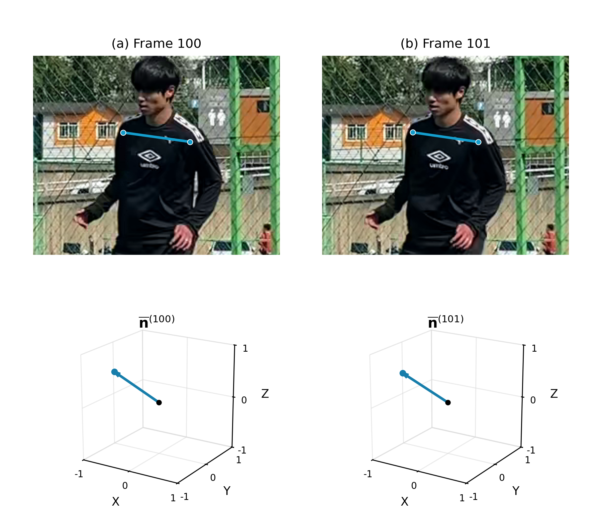
그림. 연속된 두 프레임의 어깨 벡터(상단)와 평활화된 3차원 단위 방향 벡터(하단).
공 터치 시점은 3.4절의 YOLOv8 및 SAM2 기반 공 추적 결과에서 구한다. k번째 터치 시점의 프레임을 t_k, 터치 시점 앞뒤로 각각 선택하는 프레임 수를 B_sh로 두고, 터치 구간 𝒲_k와 집계할 인접 프레임 쌍의 집합 𝒫_sh를 다음과 같이 정의한다.
$$
\color{#387dc9}{\mathcal W_k=\{t:|t-t_k|\le B_{\mathrm{sh}}\},\qquad \mathcal P_{\mathrm{sh}}=\bigcup_k\{t\in\mathcal P:t-1,t\in\mathcal W_k\}}
$$
𝒫는 원본에서 이웃한 t−1과 t가 모두 어깨 집계 조건을 만족하는 쌍의 끝 인덱스 집합이다. 𝒫_sh에는 두 프레임이 같은 터치 구간에 포함되는 쌍만 남긴다. B_sh는 어깨의 집계 범위를 나타내며, 헤드업과 동일한 시간 범위를 사용하기 위해 B_sh=16으로 설정하였다.
$$
\color{#387dc9}{V_{\mathrm{touch}}=\frac{1}{|\mathcal P_{\mathrm{sh}}|}\sum_{t\in\mathcal P_{\mathrm{sh}}}\omega^{(t)}}
$$
여기서 V_touch는 터치 구간의 어깨 평균 방향 변화 속도(°/s)이며, |𝒫_sh|는 집계한 유효 프레임 쌍의 수이다.

## 참고문헌
\[1\] V. Bazarevsky, I. Grishchenko, K. Raveendran, T. Zhu, F. Zhang, and M. Grundmann, "BlazePose: On-device Real-time Body Pose Tracking," arXiv preprint arXiv:2006.10204, 2020.
\[2\] G. Jocher, A. Chaurasia, and J. Qiu, "Ultralytics YOLOv8 (Version 8.0.0)," 2023. \[Online\]. Available: [https://github.com/ultralytics/ultralytics](https://github.com/ultralytics/ultralytics)
\[3\] N. Ravi, V. Gabeur, Y.-T. Hu, R. Hu, C. Ryali, T. Ma, et al., "SAM 2: Segment Anything in Images and Videos," arXiv preprint arXiv:2408.00714, 2024.
\[4\] A. Savitzky and M. J. E. Golay, "Smoothing and Differentiation of Data by Simplified Least Squares Procedures," Analytical Chemistry, vol. 36, no. 8, pp. 1627–1639, 1964.
\[5\] P. Virtanen, R. Gommers, T. E. Oliphant, M. Haberland, T. Reddy, D. Cournapeau, et al., "SciPy 1.0: Fundamental Algorithms for Scientific Computing in Python," Nature Methods, vol. 17, no. 3, pp. 261–272, 2020.
